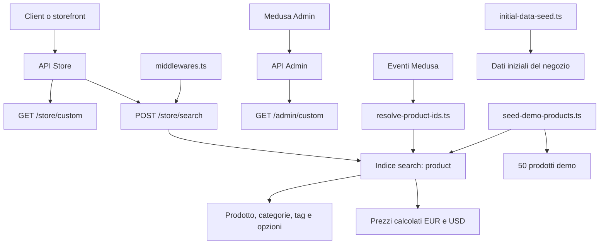

# Alberatura del backend

Stato rilevato il 14 ottobre 2026. Sono escluse le directory generate o installate
(`.medusa/`, `dist/`, `.turbo/` e `node_modules/`).

```text
apps/backend/
|-- integration-tests/
|   `-- setup.js
|-- src/
|   |-- admin/
|   |   |-- i18n/
|   |   |   |-- index.ts
|   |   |   `-- README.md
|   |   |-- README.md
|   |   |-- tsconfig.json
|   |   `-- vite-env.d.ts
|   |-- api/
|   |   |-- admin/
|   |   |   `-- custom/
|   |   |       `-- route.ts
|   |   |-- store/
|   |   |   `-- custom/
|   |   |       `-- route.ts
|   |   |-- middlewares.ts
|   |   `-- README.md
|   |-- jobs/
|   |   `-- README.md
|   |-- links/
|   |   `-- README.md
|   |-- migration-scripts/
|   |   `-- initial-data-seed.ts
|   |-- modules/
|   |   `-- README.md
|   |-- scripts/
|   |   `-- seed-demo-products.ts
|   |-- search/
|   |   |-- helpers/
|   |   |   |-- option-values.ts
|   |   |   |-- pricing.ts
|   |   |   `-- resolve-product-ids.ts
|   |   `-- product.ts
|   |-- subscribers/
|   |   `-- README.md
|   `-- workflows/
|       `-- README.md
|-- .env
|-- .env.template
|-- .gitignore
|-- eslint.config.ts
|-- instrumentation.ts
|-- jest.config.js
|-- medusa-config.ts
|-- package.json
|-- README.md
`-- tsconfig.json
```

## Mappa funzionale



## Contenuto delle cartelle

### `integration-tests/`

Configurazione di supporto ai test di integrazione. Al momento contiene solo
`setup.js`, che pulisce il `MetadataStorage` di MikroORM prima dei test. Non sono
presenti suite HTTP dentro `integration-tests/http/`.

### `src/admin/`

Spazio per estendere la dashboard Medusa con pagine, widget e traduzioni.
Attualmente non contiene componenti personalizzati:

- `i18n/index.ts` esporta un oggetto vuoto;
- i due README spiegano come aggiungere widget e traduzioni;
- `tsconfig.json` e `vite-env.d.ts` configurano il codice frontend dell'Admin.

### `src/api/`

Endpoint HTTP file-based e middleware del backend.

- `admin/custom/route.ts`: espone `GET /admin/custom` e risponde solo con HTTP
  `200`;
- `store/custom/route.ts`: espone `GET /store/custom` e risponde solo con HTTP
  `200`;
- `middlewares.ts`: abilita `POST /store/search` sull'indice `product`. Medusa
  restringe la ricerca ai prodotti pubblicati e ai sales channel accessibili
  dalla publishable API key;
- `README.md`: documentazione di esempio per route e middleware custom.

### `src/jobs/`

Destinazione per job schedulati tramite espressioni cron. Contiene solo il
README di esempio: non ci sono job attivi.

### `src/links/`

Destinazione per collegamenti tra modelli appartenenti a moduli Medusa diversi.
Contiene solo il README di esempio: non ci sono link custom.

### `src/migration-scripts/`

Script applicativi per popolare o trasformare dati.

`initial-data-seed.ts` crea i dati di base del negozio: sales channel,
publishable API key, store con EUR/USD, regione europea, tax region, magazzino,
fulfillment, spedizioni, categorie, opzioni, prodotti iniziali e livelli di
inventario.

### `src/modules/`

Destinazione per moduli custom con modelli, service e migrazioni propri.
Contiene solo il README di esempio: non esistono moduli o migrazioni custom.

### `src/scripts/`

Script eseguibili manualmente con Medusa.

`seed-demo-products.ts` crea fino a 50 prodotti demo pubblicati, in modo
idempotente tramite handle deterministici. Aggiunge collezioni, tag e opzioni,
genera varianti e prezzi nelle valute configurate e infine forza
l'aggiornamento dell'indice di ricerca.

### `src/search/`

Implementazione custom della ricerca prodotti.

- `product.ts`: dichiara l'indice `product`, i campi ricercabili, filtrabili,
  ordinabili e utilizzabili come facet; gestisce seed iniziale e aggiornamenti
  derivati dagli eventi Medusa;
- `helpers/option-values.ts`: converte le opzioni in valori piatti come
  `Size:S` e `Color:Red`, eliminando i duplicati;
- `helpers/pricing.ts`: carica i prezzi calcolati delle varianti in EUR e USD e
  produce prezzo minimo, massimo, originale e flag promozione per valuta;
- `helpers/resolve-product-ids.ts`: risale ai prodotti interessati quando cambia
  o viene eliminata una variante, un'opzione, un tag, una categoria o un sales
  channel.

### `src/subscribers/`

Destinazione per handler di eventi Medusa. Contiene solo il README di esempio:
non ci sono subscriber custom.

### `src/workflows/`

Destinazione per la business logic componibile e transazionale. Contiene solo
il README di esempio: non ci sono workflow custom.

## File principali nella root del backend

| File | Ruolo |
| --- | --- |
| `medusa-config.ts` | Carica l'ambiente e configura database URL, CORS, JWT e cookie secret. |
| `package.json` | Definisce il pacchetto `@dtc/backend`, Medusa 2.21.2 e gli script build/dev/lint/test. Richiede Node >= 22.22.0 e pnpm 12.11.2. |
| `jest.config.js` | Configura Jest/SWC e separa test unitari, integrazione moduli e integrazione HTTP tramite `TEST_TYPE`. |
| `eslint.config.ts` | Applica la configurazione ESLint raccomandata da Medusa. |
| `tsconfig.json` | Configura TypeScript e genera il server compilato sotto `.medusa/server`. |
| `instrumentation.ts` | Template disattivato per abilitare OpenTelemetry. |
| `.env` | Configurazione locale sensibile; il contenuto non è riportato in questo documento. |
| `.env.template` | Modello versionabile delle variabili d'ambiente richieste. |
| `README.md` | README standard dello starter Medusa. |

## Stato sintetico

Il backend è oggi soprattutto uno starter Medusa con una personalizzazione
concreta dedicata alla ricerca del catalogo. API custom, Admin, job, moduli,
subscriber e workflow sono ancora vuoti o contengono endpoint segnaposto. Il
repository non contiene attualmente `apps/storefront/`, quindi questa mappa è
esclusivamente backend.
